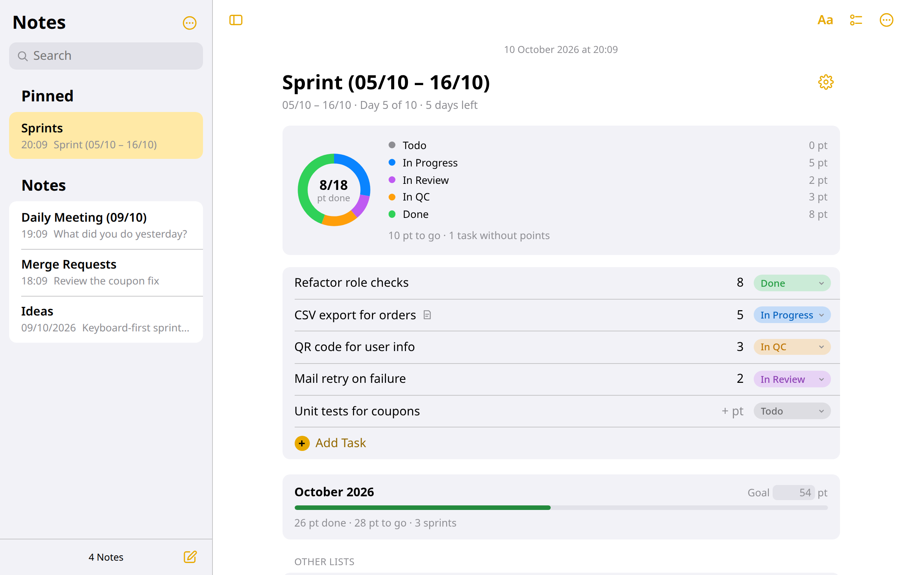
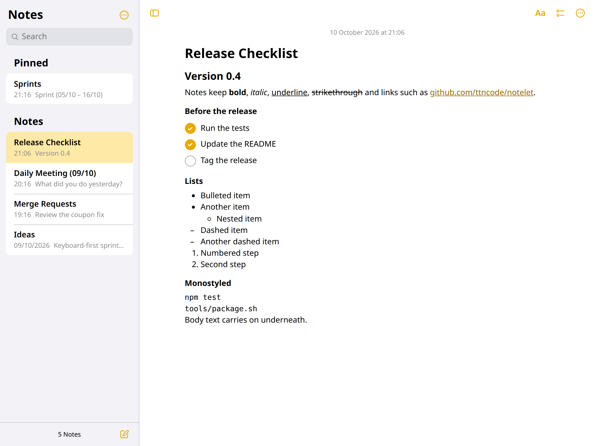
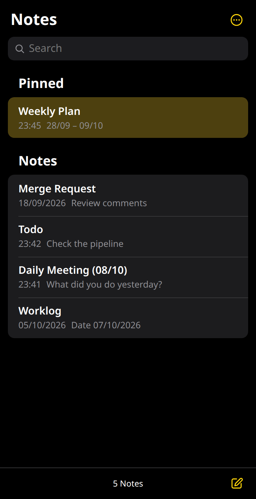
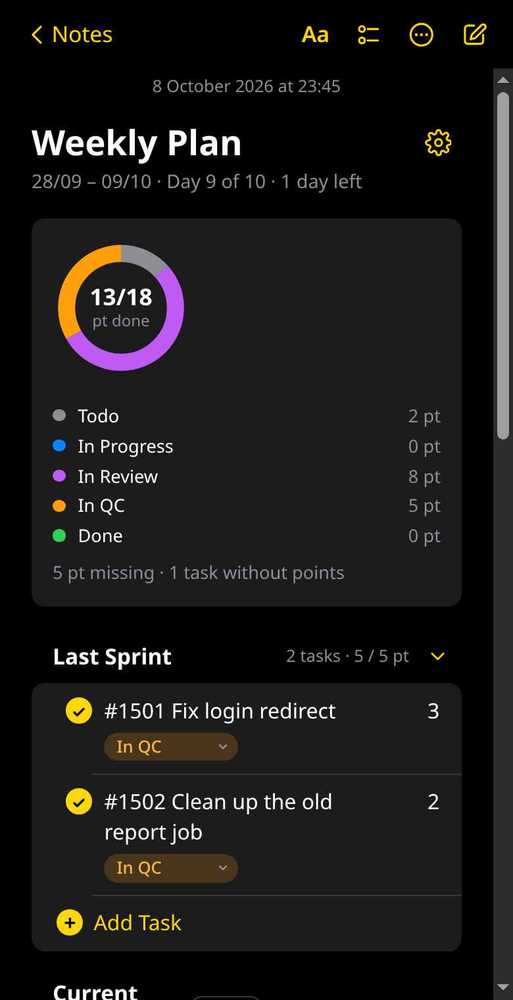
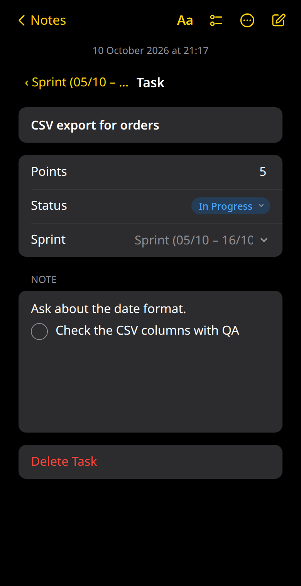
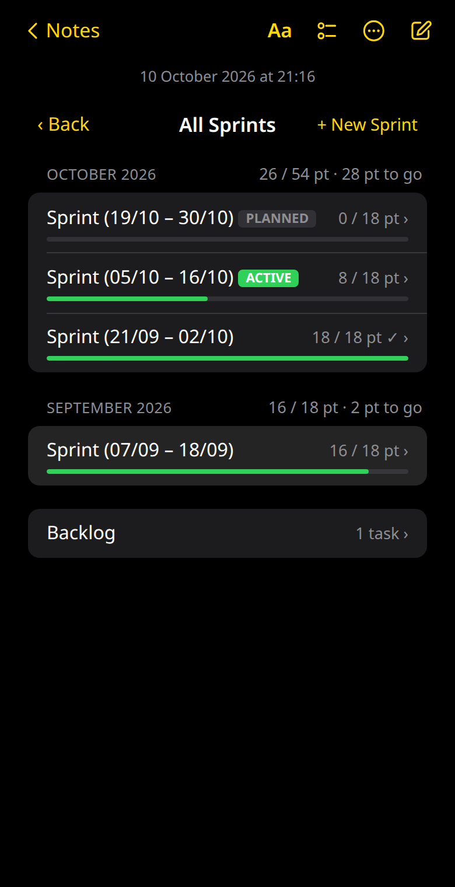
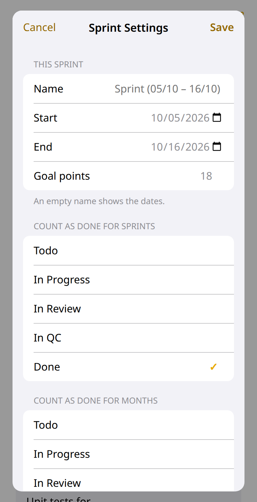
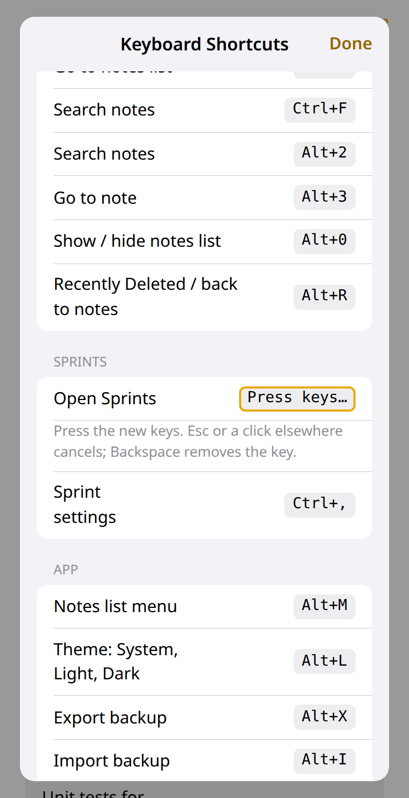

<p align="center">
  
</p>

<h1 align="center">Notelet</h1>

<p align="center">
  Notes for Windows in the style of iPhone Notes, with sprint tracking built in.<br>
  No account, no sync, nothing sent anywhere.
</p>

<p align="center">
  <a href="https://github.com/ttncode/notelet/releases/latest"></a>
  <a href="LICENSE"></a>
  
</p>

<p align="center">
  <a href="https://github.com/ttncode/notelet/releases/latest"><b>Download</b></a> ·
  <a href="#install">Install</a> ·
  <a href="#screenshots">Screenshots</a> ·
  <a href="#sprints">Sprints</a> ·
  <a href="#keyboard-shortcuts">Shortcuts</a> ·
  <a href="#back-up-and-restore">Backups</a>
</p>

<picture>
  <source media="(prefers-color-scheme: dark)" srcset="assets/screenshots/notelet-dark.png">
  
</picture>

## Highlights

- **Feels like Notes.** Title, Heading and Body styles, bulleted, dashed, numbered and check lists, pinned notes, Recently Deleted, light and dark themes. In a narrow window it switches to the iPhone layout and its slide between screens.
- **Sprints in one note.** Every sprint and a Backlog live in one Sprints note: a points donut, goals per sprint and per month, drag-and-drop tasks and a rich-text note for each task.
- **Keyboard first.** Every button has a shortcut, and you can change any of them.
- **Back and forward.** The mouse's side buttons and Alt+← / Alt+→ step through screens.
- **Private.** Notes stay in one file on your PC. Export a backup file whenever you like.


## Screenshots

### Notes, with every text style

Title, Heading and Subheading, **bold**, *italic*, underline and ~~strikethrough~~, links, checklists, bulleted, dashed, numbered and nested lists, and Monostyled text.

<picture>
  <source media="(prefers-color-scheme: dark)" srcset="assets/screenshots/notelet-note-dark.png">
  
</picture>

### The iPhone layout

In a narrow window, such as the popup, Notelet shows one screen at a time and slides between them like iPhone Notes.

<table>
  <tr>
    <td align="center" width="33%"><br><sub><b>Notes list</b></sub></td>
    <td align="center" width="33%"><br><sub><b>Current sprint</b></sub></td>
    <td align="center" width="33%"><br><sub><b>A task and its note</b></sub></td>
  </tr>
  <tr>
    <td align="center"><br><sub><b>All Sprints by month</b></sub></td>
    <td align="center"><br><sub><b>Sprint Settings</b></sub></td>
    <td align="center"><br><sub><b>Changing a shortcut</b></sub></td>
  </tr>
</table>

Notelet is an independent project and is not affiliated with or endorsed by Apple.

## Install

1. Download `Notelet_<version>_x64-setup.exe` from [Releases](https://github.com/ttncode/notelet/releases/latest).
2. Run it. Windows may warn about an unknown publisher the first time, because the installer is not code-signed: click **More info**, then **Run anyway**. It installs for your account only, so no admin rights are needed.
3. Notelet opens, adds an icon to the system tray and starts with Windows from then on.

Closing the window (X) only hides it; click the tray icon to bring it back. To quit, right-click the tray icon → **Quit**. Turn off **Start with Windows** in the same menu if you don't want it at login. The window remembers its size and place; `Alt+Enter` or the ⤢ button maximizes and restores it.

## Update

Notelet updates itself. Each time it starts it checks for a new version, installs it and reopens, so nothing is lost: any change you are typing is saved first. To check now, right-click the tray icon → **Check for updates**.

## Moving from the Chrome extension

1. In the extension, export a backup (**⋯** above the notes list → **Export**).
2. Install the desktop app.
3. On first start it offers **Import backup**; choose the file. Or use **⋯** → **Import** any time.

Notes, deleted notes, sprints, statuses, settings and custom shortcuts come across. The theme and the notes list width don't; set them again once. You can remove the extension afterwards.

## Back up and restore

Notes live in `%APPDATA%\com.ttncode.notelet\notelet.json`, with the previous save kept beside it as `notelet.json.bak`. If the file is ever damaged, Notelet opens the last good copy, or moves the damaged file aside (it is never deleted) and offers Import. The file stays on this PC only, so export regularly.

- **Export** saves every note, sprint, setting and custom shortcut to one `.json` file.
- **Import** merges a backup back in: a note with the same ID is replaced, and everything else is kept. Backups from any earlier version import, and old task-tracking notes in them join the Sprints note.

## Sprints

Press `Alt+S` (or the compose button → **Sprints**) to open the Sprints note. It holds every sprint and a Backlog, and opens on the current sprint.

| On the sprint screen | What it does |
|---|---|
| Donut | The sprint's points by status, with done points against the goal in the middle and what is left below. |
| Tasks | Each row has a title, points and a status. **+ Add Task** opens a line; Enter adds the task and starts the next, Esc stops. |
| A task | Click it to change its title, points, status or sprint, write a note with the usual text styles and checklists, or delete it. |
| Moving tasks | Drag to reorder, or drop on another sprint or the Backlog under **Other Lists**. Alt+↑ / Alt+↓ moves the focused task. |
| Month card | Adds up the sprints that end in that month. The goal is their goals added up, unless you type your own; clear it to go back to the sum. |
| ⚙ Settings | The sprint's name, dates and goal; how long new sprints run (1–4 weeks, 2 by default); which statuses count as done for sprints and for months (Done by default); the status list; delete a sprint (its tasks go to the Backlog). |

**All Sprints** lists every sprint by month with each month's progress, and **+ New Sprint** starts one the working day after the latest ends and runs to the Friday of its last week, with the same goal. When a sprint has ended with open tasks, one button moves them to the next sprint or the Backlog. Anything else goes in **Notes** under the sprint, as ordinary note text.

Task tracking notes from earlier versions are merged into the Sprints note automatically: each becomes a sprint, ticked tasks count as Done, Last Sprint tasks not already on the board go to the Backlog, and any text of their own stays as a normal note under the old title.

## Keyboard shortcuts

Press `Ctrl+/` (`⌘/` on Mac) for the full list, grouped by topic. Every button shows its shortcut in its tooltip, and lists, menus and sheets also work with Tab, the arrow keys, Enter and Esc.

| Action | Windows and Linux | Mac |
|---|---|---|
| New note | `Alt+N` | `⌥N` |
| Open Sprints | `Alt+S` | `⌥S` |
| Search notes | `Ctrl+F` | `⌘F` |
| Go to the notes list / the note | `Alt+1` / `Alt+3` | `⌥1` / `⌥3` |
| Text styles menu | `Alt+A` | `⌥A` |
| Checklist | `Ctrl+Shift+L` | `⇧⌘L` |
| Move line / duplicate line | `Alt+↑↓` / `Ctrl+Alt+Shift+↑↓` | `⌥↑↓` / `⌘⌥⇧↑↓` |
| Change case: lower, UPPER, Title | `Shift+F3` | `⇧F3` |
| Back / Forward | mouse side buttons, `Alt+←` / `Alt+→` | mouse side buttons, `⌘[` / `⌘]` |
| All shortcuts | `Ctrl+/` | `⌘/` |

Text styles follow Notes for Mac with Ctrl in place of Cmd; where Chrome kept a key for itself (Ctrl+N, Ctrl+Shift+T) Notelet uses Alt instead, the same keys as the extension had.

**To change a shortcut**, click its key in the list and press the new one. Esc, Tab or a click elsewhere cancels; Backspace removes the key. Keys Windows keeps, and those Chrome kept, are refused; a key another shortcut uses asks before taking it over. ↺ resets one shortcut; **Reset All to Default** resets them all.

## Development

```bash
npm install
npm test                  # unit tests for the UI modules
node tools/make-icons.mjs # regenerate icons, then: npx tauri icon desktop/icons/source.png -o desktop/icons
npm run tauri dev         # run the app (Windows, with Rust and the MSVC build tools)
```

The UI lives in `extension/` and runs unchanged inside the Tauri shell in `desktop/`. CI on Windows runs the unit tests, `cargo test`, clippy, a release build and end-to-end tests that press every shortcut in the built app. Working in WSL, where the Windows toolchain is not available, push a branch and let CI build it.

Pushing a `v*` tag builds the installer, signs the update, and publishes the release with the `latest.json` the app checks.

## License

[MIT](LICENSE)
